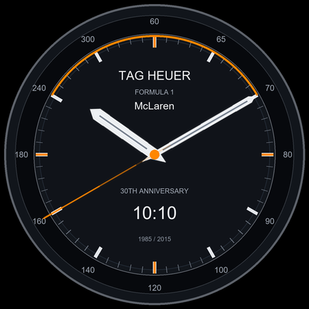

# TAG Heuer Formula 1 McLaren 30th Anniversary Watch Faces

Project Android native untuk watch face Wear OS dan aplikasi panduan Kotlin. Source tersedia di [GitHub](https://github.com/seandyadryan/tag-heuer-watch-faces).



## Cakupan

- `wear`: Watch Face Format **v1**, resource-only XML, application ID **`com.deploydulupulangnanti.tagheuermclarenwf`**. Wear OS 4+ (API 33+), analog/digital, tiga warna aksen, mode ambient.
- `companion`: Android Kotlin native (API 26+), application ID `com.deploydulupulangnanti.tagheuermclarenwf.companion`. Preview lokal, panduan pemasangan, pemilih bahasa, tautan Google Play. Tidak mentransfer watch face lewat Bluetooth.
- 21 locale lengkap untuk interface dan panduan. Bahasa lain menggunakan Inggris. Terjemahan merupakan draft yang perlu review penutur asli. Ini **bukan dukungan seluruh bahasa dunia**.
- Jam mengikuti waktu perangkat; format digital mengikuti pengaturan 12/24 jam. Desain dial dan jarum dibuat secara geometris dalam project, tanpa logo atau foto pihak ketiga.

Tidak ada satu APK yang kompatibel dengan semua smartwatch. Apple Watch/watchOS, Garmin/Connect IQ, Amazfit/Zepp, Huawei dan Samsung Tizen lama memerlukan implementasi terpisah. Model Wear OS harus menjalankan versi 4 atau lebih baru; cek OS dan ketersediaan Google Play pada model/negara target. Belum ada klaim pengujian semua model.

## Build

JDK 17, Android SDK 35 (wear) dan 36 (pendamping), Gradle wrapper disertakan. Target API wear 35 dan ponsel 36 mengikuti [persyaratan Google Play 2026](https://support.google.com/googleplay/android-developer/answer/11926878). Buka folder ini di Android Studio atau:

```powershell
./gradlew.bat :wear:assembleDebug :companion:assembleDebug :wear:lintDebug :companion:lintDebug
python tools/verify_project.py
./tools/build-release.ps1
```

Atur `sdk.dir` pada `local.properties` sesuai SDK komputer. File ini tidak di-commit. Script release meminta password tanpa menampilkannya. Keystore lokal: `D:\KEYSTORE\tag-heuer-watch-faces.jks`; alias: `tag-heuer-watch-faces`. Password tidak ditulis dalam repository.

Output: `wear/build/outputs/bundle/release/wear-release.aab`, `companion/build/outputs/bundle/release/companion-release.aab`, dan APK dalam masing-masing `build/outputs/apk/`. Kedua modul mempunyai application ID berbeda dan harus diterbitkan sebagai dua listing Play yang berbeda. Aplikasi pendamping bersifat opsional; watch face mandiri.

## GitHub runner

Workflow `Android CI` memakai **GitHub-hosted Ubuntu 24.04 runner**, berjalan pada push `main`, PR dan manual. Menjalankan build, lint, pemeriksaan resource, validator WFF resmi serta evaluator memori. Tool resmi dipin pada commit yang tercantum dalam workflow. Artifact debug dan laporan disimpan 14 hari. Workflow manual `Emulator smoke checks` menguji instalasi/launch di Android API 36 dan pemuatan WFF di Wear OS API 33, serta mengunggah screenshot dan log.

Workflow `Signed release bundles` dijalankan manual melalui Actions. Secret: `KEYSTORE_BASE64`, `RELEASE_STORE_PASSWORD`, `RELEASE_KEY_PASSWORD`, `RELEASE_KEY_ALIAS`. Keystore hanya dipulihkan di direktori temporer runner. Workflow menghasilkan signed AAB/APK dengan retensi 7 hari, tanpa upload otomatis ke Play Console. Repository collaborator dengan hak edit workflow bisa menggunakan key melalui workflow; batasi akses akun/repository.

## Panduan dan kesiapan rilis

- [Cara memasang ke smartwatch](docs/CONNECT-ID.md), [English installation guide](docs/CONNECT-EN.md).
- [Persiapan Google Play](docs/PLAY-STORE.md), [cakupan bahasa](docs/LOCALIZATION.md), [kebijakan privasi](docs/PRIVACY.md).
- [Catatan validasi](docs/VALIDATION.md) memisahkan tes otomatis dan tes perangkat yang masih harus dilakukan.

Build, signed release, validator WFF, evaluator memori, dan smoke check emulator berhasil pada 12 Oktober 2026. Screenshot aktual dan link run tersedia dalam catatan validasi. Pengujian jam fisik dan persetujuan Play Console belum dilakukan.

Project independen, tidak menyatakan afiliasi resmi. Sebelum penjualan dengan nama/desain TAG Heuer atau McLaren, dapatkan izin tertulis yang sesuai. Disclaimer di aplikasi bukan pengganti izin. [Kebijakan kekayaan intelektual Google Play](https://support.google.com/googleplay/android-developer/answer/9888072).

Google mengharuskan [Watch Face Format](https://developer.android.com/training/wearables/wff) untuk watch face pada 2026. Bundle WFF tidak dapat memuat kode Kotlin; karena itu aplikasi Kotlin dan watch face dipisahkan sesuai [petunjuk struktur Google](https://developer.android.com/training/wearables/wff/setup).
