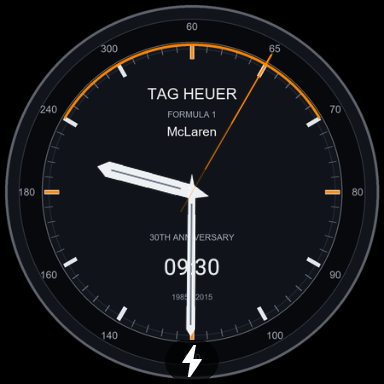

# Validation evidence

## Optional phone companion — 6.0.0 (13 October 2026)

This earlier build used the `.companion` application ID and is superseded by the
shared-package phone build. Do not upload the older artifact to the watch-face
listing. The current phone application ID is `com.deploydulupulangnanti.tagheuermclarenwf`.

- Only the companion module was incremented to versionCode 6 / versionName 6.0.0. Its application ID remains `com.deploydulupulangnanti.tagheuermclarenwf.companion`, with compile/target SDK 36 and minimum SDK 26. Wear OS remains versionCode 5 / versionName 5.0.0 and retains the requested package without a suffix.
- Local signed companion AAB/APK builds and release lint passed. APK manifest values and APK/AAB signatures were verified with the original signing certificate. Resource verification passed. This is a version-only update; application code and behavior are unchanged from the tested version 5.
- Superseded phone deliverables: `artifacts/companion-release-6.0.0/`; retained only as historical evidence. Use the shared-package build below for the current listing.

## SDK 36 release — 5.0.0 (13 October 2026)

- Both modules now use versionCode 5, versionName 5.0.0, compileSdk 36 and targetSdk 36. Minimum SDKs remain 33 (Wear OS) and 26 (Android companion).
- Clean task rerun of both release builds and release lint passed locally with JDK 17. APK badging confirms the versions and SDK values in the built packages.
- Both APK signatures and both AAB JAR signatures were verified. APK signer SHA-256 matches the original upload certificate shown below.
- The official WFF v1 schema validator and official memory-footprint evaluator passed against the release face. Resource contracts, all 21 locale sets and the wearable no-DEX check passed.
- [CI passed](https://github.com/seandyadryan/tag-heuer-watch-faces/actions/runs/38341658858) for source commit `55f79f2`.
- Local signed deliverables are in `artifacts/release-5.0.0/`; application IDs, artwork and behavior are unchanged. Prior screenshots remain representative.
- [Signed release passed](https://github.com/seandyadryan/tag-heuer-watch-faces/actions/runs/38341791350), producing signed AAB/APK files for both modules.
- [Emulator checks passed](https://github.com/seandyadryan/tag-heuer-watch-faces/actions/runs/38341770454): phone API 36 launch/locale/guide checks and Wear OS API 33 install/runtime/render checks, verifying backward compatibility with the new target SDK. Physical device testing and Play Console review remain outstanding.

## Reference dial update — 1.1.0

- [CI passed](https://github.com/seandyadryan/tag-heuer-watch-faces/actions/runs/38232787289): both builds/lint, WFF schema, resource references and pivots, full locale sets, and official memory test.
- [Signed release passed](https://github.com/seandyadryan/tag-heuer-watch-faces/actions/runs/38232790676): version code 2 / 1.1.0 AABs and APKs for both modules. APK signer matches the existing keystore SHA-256 below.
- [Emulator checks passed](https://github.com/seandyadryan/tag-heuer-watch-faces/actions/runs/38232798899): the red reference dial is visible on Wear OS API 33, with separate moving subdial hands and the actual day-of-month rendered in the date aperture. Android API 36 phone preview and locale checks also passed.
- The composed preview and actual Wear OS screenshot were visually inspected. Conservative decoded artwork upper bound is 3.89 MiB, including retained original assets. The high-resolution source master is outside Android resources and is not shipped in the APK.

## Verified on 12 October 2026

- [Android CI passed](https://github.com/seandyadryan/tag-heuer-watch-faces/actions/runs/38229884979): builds/lint for both modules, full 21-locale resource contracts, official WFF v1 schema validator, and official memory-footprint test (10 MB ambient / 100 MB active limits).
- [Signed release passed](https://github.com/seandyadryan/tag-heuer-watch-faces/actions/runs/38228479264): both release AABs/APKs, target API 35 for Wear OS and 36 for the phone. Application source is unchanged by subsequent smoke-test/runner/documentation commits.
- [Emulator smoke checks passed](https://github.com/seandyadryan/tag-heuer-watch-faces/actions/runs/38229887160): Wear OS API 33 install, WFF runtime selection and a visible papaya dial; Android API 36 phone launch, English/Indonesian/Arabic locale switching, and scrolling the Indonesian installation guide. Screenshots were visually reviewed.
- Wear APK and AAB contain no DEX. APK signature verified with Android `apksigner`; AAB signature verified with `jarsigner`. Signer matches the local keystore certificate: SHA-256 `5acee92e74307870f22a517136bbba0b1e61c1ea2b12becc797caeddad1c0a27`.
- Toolchain: JDK 17, AGP 8.10.1, Kotlin 2.1.21, Gradle 8.11.1. GitHub-hosted runner pinned to Ubuntu 24.04.

[Actual Indonesian installation guide screenshot](images/phone-guide-id.png)

Automated checks cover builds/lint, the pinned official WFF v1 validator, reference integrity, hand-pivot coordinates, ambient second-hand visibility, complete locale key sets, and absence of DEX in wearable APK. The official memory-footprint evaluator is configured in GitHub CI. Logs and APKs are downloadable from Actions.

The decoded image upper bound script is a conservative artwork check, not a replacement for Google's official evaluator or device performance testing. No test proves compatibility with every smartwatch or every language. Only one Wear OS emulator profile and one phone emulator profile have been tested; the other 18 interface locales have resource-completeness checks but no emulator/native-speaker review.

Before commercial release, validate installation from Play internal testing on physical devices, ambient brightness/burn-in behavior, battery impact, timezone/DST changes, 12/24-hour settings, watch customization, small and large screens, phone large-font layouts and all locale translations. Play Console review and trademark authorization remain outside automated build validation.
